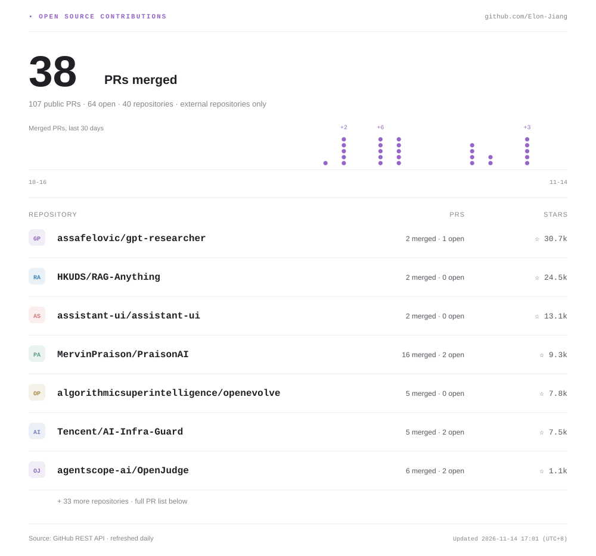

<!-- Generated by scripts/generate_stats.py. Edit profile.json to customize. -->

<picture>
  <source media="(prefers-color-scheme: dark)" srcset="./assets/hero-dark.svg">
  <source media="(prefers-color-scheme: light)" srcset="./assets/hero-light.svg">
  
</picture>

<picture>
  <source media="(prefers-color-scheme: dark)" srcset="./assets/contributions-dark.svg">
  <source media="(prefers-color-scheme: light)" srcset="./assets/contributions-light.svg">
  
</picture>

[61 个公开 PR](https://github.com/pulls?q=is%3Apr+author%3AElon-Jiang+is%3Apublic+-user%3AElon-Jiang) · **24 已合并 / 35 待合并 / 2 关闭未合并**

仅统计公开仓库中由我创建、提给他人仓库的 PR；仓库 Star 数属于所贡献的项目。

查看全部 61 个 PR 与贡献仓库

| 仓库 | PR | 状态 |
| :--- | :--- | :--- |
| [MervinPraison/PraisonAI](https://github.com/MervinPraison/PraisonAI) | [#6199 fix(ts): interrupt tool retry backoff on cancellation](https://github.com/MervinPraison/PraisonAI/pull/6199) | 已合并 |
| [MervinPraison/PraisonAI](https://github.com/MervinPraison/PraisonAI) | [#6198 fix(ts): enforce tool payload limits in UTF-8 bytes](https://github.com/MervinPraison/PraisonAI/pull/6198) | 已合并 |
| [MervinPraison/PraisonAI](https://github.com/MervinPraison/PraisonAI) | [#6197 fix(ts): invalidate tool installation cache on registration changes](https://github.com/MervinPraison/PraisonAI/pull/6197) | 已合并 |
| [MervinPraison/PraisonAI](https://github.com/MervinPraison/PraisonAI) | [#6196 fix(ts): re-enter downstream tool middleware on retry](https://github.com/MervinPraison/PraisonAI/pull/6196) | 已合并 |
| [MervinPraison/PraisonAI](https://github.com/MervinPraison/PraisonAI) | [#6195 fix(ts): release hook deadline timers after settlement](https://github.com/MervinPraison/PraisonAI/pull/6195) | 已合并 |
| [MervinPraison/PraisonAI](https://github.com/MervinPraison/PraisonAI) | [#6194 fix(ts): keep hook inspection from freezing registration](https://github.com/MervinPraison/PraisonAI/pull/6194) | 已合并 |
| [MervinPraison/PraisonAI](https://github.com/MervinPraison/PraisonAI) | [#6193 fix(ts): preserve concurrent FileCache list appends](https://github.com/MervinPraison/PraisonAI/pull/6193) | 已合并 |
| [MervinPraison/PraisonAI](https://github.com/MervinPraison/PraisonAI) | [#6192 fix(ts): initialize and route MCP stdio requests correctly](https://github.com/MervinPraison/PraisonAI/pull/6192) | 待合并 |
| [MervinPraison/PraisonAI](https://github.com/MervinPraison/PraisonAI) | [#6191 fix(ts): remove stale graph neighbors when an edge is rewired](https://github.com/MervinPraison/PraisonAI/pull/6191) | 已合并 |
| [MervinPraison/PraisonAI](https://github.com/MervinPraison/PraisonAI) | [#6190 fix(ts): ensure fixed-size chunking always advances](https://github.com/MervinPraison/PraisonAI/pull/6190) | 待合并 |
| [MervinPraison/PraisonAI](https://github.com/MervinPraison/PraisonAI) | [#6188 fix(ts): preserve sentence chunk content and source offsets](https://github.com/MervinPraison/PraisonAI/pull/6188) | 已合并 |
| [MervinPraison/PraisonAI](https://github.com/MervinPraison/PraisonAI) | [#6186 fix(ts): preserve session changes during file saves](https://github.com/MervinPraison/PraisonAI/pull/6186) | 已合并 |
| [genkit-ai/genkit](https://github.com/genkit-ai/genkit) | [#7000 fix(py): isolate generated output format metadata](https://github.com/genkit-ai/genkit/pull/7000) | 待合并 |
| [genkit-ai/genkit](https://github.com/genkit-ai/genkit) | [#6999 fix(py): preserve message metadata when injecting output instructions](https://github.com/genkit-ai/genkit/pull/6999) | 待合并 |
| [algorithmicsuperintelligence/openevolve](https://github.com/algorithmicsuperintelligence/openevolve) | [#578 fix(llm): stop Codex process before closing read pipes](https://github.com/algorithmicsuperintelligence/openevolve/pull/578) | 已合并 |
| [algorithmicsuperintelligence/openevolve](https://github.com/algorithmicsuperintelligence/openevolve) | [#577 fix(llm): use UTF-8 for model CLI text pipes](https://github.com/algorithmicsuperintelligence/openevolve/pull/577) | 已合并 |
| [algorithmicsuperintelligence/openevolve](https://github.com/algorithmicsuperintelligence/openevolve) | [#576 fix(llm): reject failed Claude CLI responses before returning stdout](https://github.com/algorithmicsuperintelligence/openevolve/pull/576) | 已合并 |
| [algorithmicsuperintelligence/openevolve](https://github.com/algorithmicsuperintelligence/openevolve) | [#575 fix(trace): keep JSON export metadata reusable](https://github.com/algorithmicsuperintelligence/openevolve/pull/575) | 已合并 |
| [MervinPraison/PraisonAI](https://github.com/MervinPraison/PraisonAI) | [#6184 fix(ts): settle MCP requests when WebSocket connections close](https://github.com/MervinPraison/PraisonAI/pull/6184) | 已合并 |
| [MervinPraison/PraisonAI](https://github.com/MervinPraison/PraisonAI) | [#6183 fix(ts): evict empty keys from bounded MemoryCache](https://github.com/MervinPraison/PraisonAI/pull/6183) | 已合并 |
| [MervinPraison/PraisonAI](https://github.com/MervinPraison/PraisonAI) | [#6180 fix(ts): honor the configured FileCache TTL](https://github.com/MervinPraison/PraisonAI/pull/6180) | 已合并 |
| [genkit-ai/genkit](https://github.com/genkit-ai/genkit) | [#6998 fix(py): handle recursive schemas in array and JSONL formats](https://github.com/genkit-ai/genkit/pull/6998) | 待合并 |
| [MervinPraison/PraisonAI](https://github.com/MervinPraison/PraisonAI) | [#6178 fix(ts): resolve MCP WebSocket responses with zero request IDs](https://github.com/MervinPraison/PraisonAI/pull/6178) | 已合并 |
| [assafelovic/gpt-researcher](https://github.com/assafelovic/gpt-researcher) | [#2252 fix(document): detect online document type from URL path](https://github.com/assafelovic/gpt-researcher/pull/2252) | 待合并 |
| [genkit-ai/genkit](https://github.com/genkit-ai/genkit) | [#6996 fix(py): ignore SSE heartbeat comments in agent streams](https://github.com/genkit-ai/genkit/pull/6996) | 待合并 |
| [genkit-ai/genkit](https://github.com/genkit-ai/genkit) | [#6995 fix(py): compare session snapshot creation instants chronologically](https://github.com/genkit-ai/genkit/pull/6995) | 待合并 |
| [simular-ai/Agent-S](https://github.com/simular-ai/Agent-S) | [#253 fix(s4): quote paths when archiving interface variants](https://github.com/simular-ai/Agent-S/pull/253) | 待合并 |
| [NevaMind-AI/memU](https://github.com/NevaMind-AI/memU) | [#775 fix(embedding): skip empty SDK embedding requests](https://github.com/NevaMind-AI/memU/pull/775) | 待合并 |
| [genkit-ai/genkit](https://github.com/genkit-ai/genkit) | [#6992 fix(py): preserve application import errors in run_main](https://github.com/genkit-ai/genkit/pull/6992) | 待合并 |
| [genkit-ai/genkit](https://github.com/genkit-ai/genkit) | [#6991 fix(py): preserve nullable chunks in waiting stream readers](https://github.com/genkit-ai/genkit/pull/6991) | 待合并 |
| [assafelovic/gpt-researcher](https://github.com/assafelovic/gpt-researcher) | [#2250 fix(vector-store): skip empty chunk batches](https://github.com/assafelovic/gpt-researcher/pull/2250) | 待合并 |
| [2FastLabs/agent-squad](https://github.com/2FastLabs/agent-squad) | [#726 fix(python): preserve memory and SQL message timestamps](https://github.com/2FastLabs/agent-squad/pull/726) | 待合并 |
| [2FastLabs/agent-squad](https://github.com/2FastLabs/agent-squad) | [#724 fix(storage): persist raw messages before updating summaries](https://github.com/2FastLabs/agent-squad/pull/724) | 待合并 |
| [agentscope-ai/OpenJudge](https://github.com/agentscope-ai/OpenJudge) | [#204 fix(runner): reject nonpositive concurrency](https://github.com/agentscope-ai/OpenJudge/pull/204) | 已合并 |
| [VoltAgent/voltagent](https://github.com/VoltAgent/voltagent) | [#1492 fix(core): snapshot in-memory persistence payloads](https://github.com/VoltAgent/voltagent/pull/1492) | 待合并 |
| [VoltAgent/voltagent](https://github.com/VoltAgent/voltagent) | [#1491 fix(core): scope composite filesystem searches to requested paths](https://github.com/VoltAgent/voltagent/pull/1491) | 待合并 |
| [langchain-ai/langchainjs](https://github.com/langchain-ai/langchainjs) | [#12077 fix(core): preserve prototype property names in RunnableMap](https://github.com/langchain-ai/langchainjs/pull/12077) | 待合并 |
| [algorithmicsuperintelligence/openevolve](https://github.com/algorithmicsuperintelligence/openevolve) | [#568 fix(llm): avoid assuming custom clients store a model field](https://github.com/algorithmicsuperintelligence/openevolve/pull/568) | 已合并 |
| [MemoriLabs/Memori](https://github.com/MemoriLabs/Memori) | [#650 fix(llm): preserve synchronous streaming during client registration](https://github.com/MemoriLabs/Memori/pull/650) | 待合并 |
| [HKUDS/RAG-Anything](https://github.com/HKUDS/RAG-Anything) | [#454 fix(resilience): await all asynchronous retry callback results](https://github.com/HKUDS/RAG-Anything/pull/454) | 待合并 |
| [HKUDS/LightRAG](https://github.com/HKUDS/LightRAG) | [#4288 fix(utils): preserve cosine direction across finite vector scales](https://github.com/HKUDS/LightRAG/pull/4288) | 待合并 |
| [microsoft/agent-lightning](https://github.com/microsoft/agent-lightning) | [#667 fix(controller): await non-coroutine local worker results](https://github.com/microsoft/agent-lightning/pull/667) | 关闭未合并 |
| [browser-use/browser-use](https://github.com/browser-use/browser-use) | [#6260 fix(tokens): preserve concurrent pricing cache snapshots](https://github.com/browser-use/browser-use/pull/6260) | 待合并 |
| [HKUDS/LightRAG](https://github.com/HKUDS/LightRAG) | [#4287 fix(vlm): accept case-insensitive image data URLs](https://github.com/HKUDS/LightRAG/pull/4287) | 待合并 |
| [HKUDS/DeepCode](https://github.com/HKUDS/DeepCode) | [#288 fix(paper2code): preserve fenced code in paper sections](https://github.com/HKUDS/DeepCode/pull/288) | 待合并 |
| [browserbase/stagehand](https://github.com/browserbase/stagehand) | [#3360 fix(sdk-ts): observe rejected operations after pre-abort](https://github.com/browserbase/stagehand/pull/3360) | 待合并 |
| [MervinPraison/PraisonAI](https://github.com/MervinPraison/PraisonAI) | [#6149 fix(ts): preserve arbitrary session state keys](https://github.com/MervinPraison/PraisonAI/pull/6149) | 已合并 |
| [MervinPraison/PraisonAI](https://github.com/MervinPraison/PraisonAI) | [#6147 fix(ts): reject negative memory capacities](https://github.com/MervinPraison/PraisonAI/pull/6147) | 关闭未合并 |
| [e2b-dev/E2B](https://github.com/e2b-dev/E2B) | [#2072 fix(python-sdk): notify on_exit after immediate watch stop](https://github.com/e2b-dev/E2B/pull/2072) | 待合并 |
| [agentscope-ai/OpenJudge](https://github.com/agentscope-ai/OpenJudge) | [#203 fix(analyzer): restore consistency call support](https://github.com/agentscope-ai/OpenJudge/pull/203) | 已合并 |
| [confident-ai/deepeval](https://github.com/confident-ai/deepeval) | [#3560 fix(classifiers): match whitespace-padded label names](https://github.com/confident-ai/deepeval/pull/3560) | 待合并 |
| [browserbase/stagehand](https://github.com/browserbase/stagehand) | [#3355 fix(sdk-ts): reject FIFO uploads without blocking](https://github.com/browserbase/stagehand/pull/3355) | 待合并 |
| [VoltAgent/voltagent](https://github.com/VoltAgent/voltagent) | [#1490 fix(evals): propagate experiment callback failures](https://github.com/VoltAgent/voltagent/pull/1490) | 待合并 |
| [Tencent/AI-Infra-Guard](https://github.com/Tencent/AI-Infra-Guard) | [#733 fix(mcp-scan): normalize mixed-case MCP SARIF rule IDs](https://github.com/Tencent/AI-Infra-Guard/pull/733) | 已合并 |
| [HKUDS/DeepCode](https://github.com/HKUDS/DeepCode) | [#287 fix(memory): keep distinct topic pointers during consolidation](https://github.com/HKUDS/DeepCode/pull/287) | 待合并 |
| [CopilotKit/CopilotKit](https://github.com/CopilotKit/CopilotKit) | [#8114 fix(core): handle inherited property names in thread store registry](https://github.com/CopilotKit/CopilotKit/pull/8114) | 待合并 |
| [MervinPraison/PraisonAI](https://github.com/MervinPraison/PraisonAI) | [#6142 fix(ts): recover FileMemory writes after append failures](https://github.com/MervinPraison/PraisonAI/pull/6142) | 已合并 |
| [CopilotKit/CopilotKit](https://github.com/CopilotKit/CopilotKit) | [#8111 fix(core): replace all case variants when overlaying headers](https://github.com/CopilotKit/CopilotKit/pull/8111) | 待合并 |
| [TencentCloud/Octop](https://github.com/TencentCloud/Octop) | [#2625 fix(dashboard): display custom ACP runner names and commands](https://github.com/TencentCloud/Octop/pull/2625) | 待合并 |
| [TencentCloud/Octop](https://github.com/TencentCloud/Octop) | [#2624 fix(dashboard): keep HTML preview anchors inside the document](https://github.com/TencentCloud/Octop/pull/2624) | 待合并 |
| [pydantic/pydantic-ai](https://github.com/pydantic/pydantic-ai) | [#11833 Allow `Coder` and `Researcher` to load from agent specs](https://github.com/pydantic/pydantic-ai/pull/11833) | 草稿 |

---

统计每日自动更新 · [更新记录](https://github.com/Elon-Jiang/Elon-Jiang/actions/workflows/update-profile.yml)
